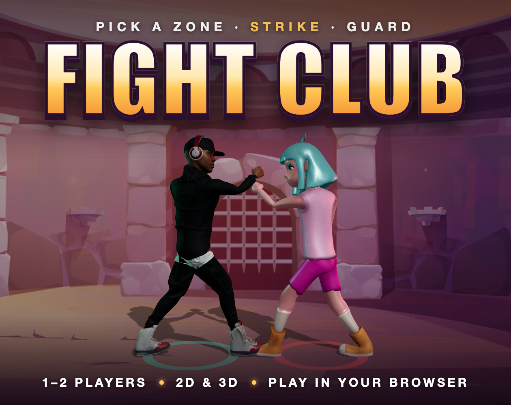

# Fight Club



A turn-based browser duel in the spirit of the old "fight club" web games. Every round both fighters secretly pick a zone to
**strike** and a zone to **guard**: head, body or legs. Guard exactly the zone the opponent strikes and you take nothing.
Whoever runs out of health first loses.

- **Health:** 100 each. A landed strike rolls 8-14 damage.
- **Hand or foot, fast or slow.** You choose what to strike with. A **punch** is fast and steady. A **kick** does 1.4x the damage, but it is
  **slow**, and if the other fighter guards that zone you **stumble**: -7 health and your combo is gone. A kick pays off when you think you
  are not being read; against a guard that reads you, punch.
- **The strikes come one after the other.** You both choose in secret and at once (a guard and a strike), but the round is played in two
  beats, with a caption for each: who strikes where with what, and where the other one is guarding. The **faster strike goes first**: a
  punch before a kick. With the same weapon the **more wounded fighter** is quicker, and only when that is equal too does a coin decide.
  A **knockout ends the round**: the fighter who is down does not strike back, so a critical hit on the first strike can decide the
  match. There is **no draw**.
- **Combo:** every strike you land in a row makes the next one hit +2 harder (up to +8). A guarded strike resets it.
- **Critical hits:** 15% of the strikes that are not guarded do double damage.
- **The enemy learns.** *Easy* guesses blindly. *Normal* studies your habits (newer rounds count more) and guards where you
  tend to strike and strikes where you tend not to guard. *Hard* does the same but almost always takes the likeliest zone.
  The smarter enemies also pick the weapon: they kick when they expect the zone to be open. It only ever looks at your past
  rounds, never at the move you are choosing now.
- **Everything is on the field.** The arena fills the window. You choose by **tapping the fighters**: a tap on James picks the zone to guard,
  a tap on Amy the zone to strike (the zone lights up under the pointer first). The punch and the kick are two buttons at the left edge
  (James's side), the one that starts the fight at the right edge (Amy's). The hint is under the health bars; each fighter's last two
  strikes are listed under each health bar, below the combo, the older ones fading away. The bars, the combo and the log follow the replay:
  they change at the moment each blow lands.
- **A short intro** (2.3 s) opens every match: the names slide in, "VS" slams down between the fighters and is gone, then "FIGHT!"
  and a bell. Nothing stays on the arena afterwards. It does not block the controls.
- **Two players on one screen, one after the other.** James (the left fighter) chooses first: tap himself to guard, Amy to strike, a punch or a
  kick, **Lock in** - and his picks disappear at once. Then it is Amy's turn (she taps herself to guard and James to strike) and her
  **Fight!** starts the round. The hint says whose turn it is and asks the other one to look away. A duel between two people does not
  count toward your record.
- **Jointed fighters, aimed strikes.** Both views draw the same skeleton: pelvis, waist, neck, shoulders, elbows, hips, knees
  and ankles. Every strike goes to the zone you chose: at the moment of contact the fist or the foot is solved (two-link
  inverse kinematics) to reach that zone of the opponent's body, wherever the opponent's head, chest or shin is at that moment,
  and the two fighters close in just enough for each to reach. A strike has a wind-up, a lunge, a follow-through and a
  recovery; a kick chambers the knee first. The hit is reacted to by zone (the head snaps back, the body doubles over, the legs
  buckle), a guard brings the forearms (or the knee) up in front of the zone, a guarded kick makes the kicker stagger, a knockout
  folds the knees and falls, the winner raises both fists. Sounds are timed to the moment of contact.
- **2D or 3D.** The same game drawn two ways: flat SVG figures, or a 3D ring built with React Three Fiber (the fighters are made
  of primitives; a punch swings the near arm, a kick swings the near leg, the camera drifts). Switch any time with `V`.
  three.js is a lazy chunk (about 245 kB gzipped): it is downloaded only the first time you open the 3D view.

Your record against the enemy (wins, losses, fastest win, most health left), the difficulty, the number of players and the view
are remembered in the browser.

Built on the same stack as deorbit: TypeScript, Vite, React, React Three Fiber, zustand, vitest, oxlint, pnpm.
Every sound is synthesised with Web Audio (no files).

## Characters (3D, optional)

The 3D view can use real characters from [Mixamo](https://www.mixamo.com): **James** and **Amy**, chosen on the Select fighter screen. The pose is
still computed by `computePose` and applied to an invisible driver skeleton; the character's 65 bones are turned and placed to
follow it every frame (`src/ui/rig.ts`: a direction and a position for each bone, the shortest arc from the T-pose, a lateral axis
where the twist matters, closed fists). The limbs are fitted to the proportions of the driver skeleton, so a strike aimed at a
zone still arrives at it; the head is enlarged a little to meet the fists. The hit flash and the glow of a zone are done in the
character's own material (every vertex knows which zone its bone belongs to), so the glow follows the shape of the body.

Mixamo's licence allows its characters inside a game but not as files in a public repository, so the models are **not** in git
(`assets-src/` and `public/models/` are ignored). Without them the 3D view draws the primitive fighters and everything works.
To use the characters:

1. In Mixamo pick a character, **do not pick an animation**, Download: Format `FBX Binary (.fbx)`, Pose **`T-pose`**.
2. Unzip each download into its own folder: `assets-src/james/`, `assets-src/amy/` (the big `.fbx` is the character).
3. `pnpm models` converts them to `public/models/james.glb` and `public/models/amy.glb`: FBX to glTF, the 4096 px textures
   shrunk to 1024 px and re-encoded as WebP (25-55 MB each become 1-3 MB). The fighters (name, model, face, height, whether they
   are there from the start) are listed in `src/state/roster.ts`.
4. `pnpm portraits shot.png` cuts the faces for the tiles of the Select fighter screen (`public/models/<id>.webp`) out of a
   screenshot of the poster scene (the command and the window size are at the top of `scripts/make-portraits.mjs`). Without a face
   a tile shows the first letter of the name.

The models are loaded only when the 3D view is opened (like three.js itself).

## Arenas (backgrounds, optional)

The setup screen lets you choose the arena to fight in: a picture behind the fighters, in 2D and in 3D (the 3D scene is transparent
and its floor only catches the shadows). The choice is remembered; `B` on the setup screen goes to the next one, and "Plain" is the
dark arena without a picture. The pictures are not in git (stock pictures usually may be used in a game but not redistributed as
files, and may need a credit: check the licence of yours), so without them the game simply has no choice to offer.

1. Put a picture (JPG / PNG) into `assets-src/arena-<name>/`, one folder for every arena: `assets-src/arena-night/`, ...
2. `pnpm arenas` makes `public/arenas/<name>.webp` (at most 1920 px wide), a thumbnail and the list `arenas.json`. The name shown in
   the game is the folder's: `arena-old-fort` is "Old fort". A 6500 px picture of several MB becomes 50-400 kB. An optional
   `arena.json` next to the picture can set `name` and `stand` (how far down the frame the fighters stand, a fraction of its
   height: `{ "stand": 0.05 }` puts them a little nearer to us and further from the back wall).

## Poster scene (dev only)

`pnpm dev`, then open `/poster.html?arena=sunset&t=285&yaw=55&p=head.hand&e=head.hand`: the 3D arena with the two characters frozen
in the middle of a strike and with their faces turned to the camera, filling the window, for the cover picture and screenshots
(parameters are listed at the top of `src/poster.tsx`). It is not part of the game's build.

## Run

```bash
pnpm install
pnpm dev        # http://localhost:5173
pnpm check      # typecheck + lint + tests
pnpm build      # static site in dist/
```

## Game modes

The main menu: **Tournament** (not made yet: a row of opponents, each beaten one becomes a fighter you can choose), **Arcade Mode** (one
player against the enemy), **VS Mode** (two players, one screen) **Options** (not made yet) and **About** (the rules). Arcade and VS lead to a setup screen
(difficulty, arena, view), then to **Select fighter**: a grid of faces (4 across in a wide window, 3 across in a tall one, 12 tiles),
where the fighters that are not unlocked yet are "?" (nothing unlocks yet: the tournament is not made). Alone you choose your
fighter and the enemy is another one; in VS Mode the first player chooses, then the second (not the same one). Then the fight.

## Controls

Mouse or touch: tap a fighter to choose a zone (see above), then the punch / kick buttons and the fight button. With the keyboard, the nine
keys of a player are laid out like the old picture, left to right and top to bottom (the label on a key never changes):

| | Guard zone | Buttons | Strike zone |
|---|---|---|---|
| **top** | `Q` head | `W` punch | `E` head |
| **middle** | `A` body | `S` kick | `D` body |
| **bottom** | `Z` legs | `X` fight | `C` legs |

| Input | Action |
|---|---|
| `Enter` / `Space` | confirm for whoever is choosing (fight, lock in), skip the replay, start, play again |
| `↑` `↓` (or `W` `S`) | move the cursor in the main menu |
| `1` `2` `3` | difficulty (setup screen, arcade) |
| `V` | 2D / 3D view (also two buttons on the setup screen) |
| `B` | the next arena (setup screen) |
| arrows / `W` `A` `S` `D` | move over the tiles of the Select fighter screen; `Enter` chooses |
| `Esc` | back (from Select fighter one step, from the about, setup and end screens to the menu) |
| `Esc` in a fight | pause (also the ⏸ button in the header): `↑` `↓` and `Enter` choose Continue or Reset (= the main menu); `Esc` continues |
| `M` | mute |

Between two people the second player's keys are `I` `J` `,` (guard head / body / legs), `O` `K` `.` (punch, kick, fight) and `P` `L` `/` (strike
head / body / legs). Only the keys of the one whose turn it is do anything.

## How it is organised

```
src/sim/      pure TypeScript rules and enemy AI - no React, no stores (a lint rule keeps it that way)
src/state/    zustand stores: the game flow (title -> choose -> reveal -> over), settings (mode, view, difficulty), your record
src/ui/       the HUD, the controls, the log, the title / end screens; the arena as flat SVG (Fighter) or 3D (Arena3D, Fighter3D,
              lazy-loaded). Both draw from one `FighterView` (arenaView.ts) and one skeleton (pose.ts: a pure
              function from time to joint angles, with the aiming and the choreography), so they always agree
src/audio/    synthesised sound effects
src/timing.ts the moment a strike connects
scripts/      prepare-models.mjs: Mixamo FBX -> optimised GLB (see Characters); prepare-arenas.mjs: pictures -> arenas (the animation and the sounds are timed to it)
tests/        vitest
```

- **All randomness is injected** (`Rng`), so the rules and the AI are tested with scripted and seeded dice.
- `resolveRound` takes both fighters' moves, so two people and a person against the AI share the same rules; `playRound` is
  just the AI picking the second move first.
- Tuning lives in `src/sim/config.ts` (health, damage, crit chance, combo bonus, kick multiplier and stumble, AI memory and confidence). The order of the
  strikes is `whoFirst` in `src/sim/round.ts`; when each beat starts and lands is `src/timing.ts` (`BEAT`, `LEAD`, `IMPACT`), shared by the animation,
  the sounds, the captions and the health bars. The enemy does not kick when it is nearly out of health (a kick is slow).
